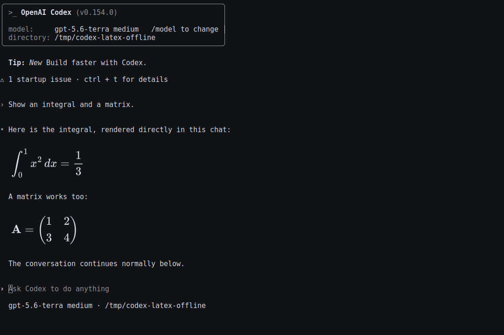

# Codex LaTeX

A Codex CLI fork with graphical LaTeX rendering, saved conversation branches,
and an SSH terminal synchronization fix. It uses your existing Codex account,
settings, and saved conversations.

## Features

| Feature | Behavior |
| --- | --- |
| LaTeX rendering | Renders assistant equations as MathJax images among the chat paragraphs, with text fallback when rendering is unavailable. |
| Conversation branches | `/branch [name]` creates a saved child conversation with the current history. Children can have their own branches. |
| Conversation tree | `/tree` browses the current conversation's parent, siblings, and descendants; select a conversation to continue it. |
| SSH terminal synchronization | Allows delayed cursor and color responses to arrive before using fallback positions and colors. |
| Zellij integration | Runs in the current pane and uses `zellij-codex-launch` for conversation registration and lifecycle badges when that separate integration is installed. |
| Terminal appearance | The graphical launcher preserves terminal colors and follows pane visibility, layout changes, and Zellij scrollback on supported X11 desktops. |



## Build and run the SSH-aware CLI

Install Git, Python 3.11+, and the Rust toolchain specified in
[codex-rs/rust-toolchain.toml](codex-rs/rust-toolchain.toml), with Cargo and
`rustc` on PATH. From Bash:

```bash
git clone https://github.com/rogeriofonteles/codex-latex.git ~/code/codex
cd ~/code/codex
./scripts/build-ssh.sh
./bin/codex
```

If the repository is already checked out, run the last three commands using
its existing location. The build compiles the CLI and matching code-mode helper
with the `dev-small` profile. It downloads checksum-verified Codex V8 artifacts
when needed and restores the checked-in Cargo lockfile after building.
Builds use four jobs by default; override with `CARGO_BUILD_JOBS=2`, for example.

Use the same launcher to resume a conversation:

```bash
./bin/codex resume
```

Existing shell or Zellij launchers can point to `bin/codex`. Restart existing
CLI sessions after rebuilding to load the new executable.

## Graphical LaTeX

The optional `codex-latex` launcher requires additional local dependencies and
an X11/XWayland terminal. Follow the dedicated
[LaTeX setup and rebuild guide](latex-preview/README.md) for installation,
Node.js/Python requirements, supported terminal geometry, and validation.
After installing that launcher:

```bash
codex-latex
codex-latex resume
codex-latex --window resume
codex-latex --plain resume
codex-latex --demo
```

By default, graphical formulas use the current Zellij pane when a usable local
X11 window is available. `--window` opens a separate Alacritty window.
`--plain` uses the ordinary Codex launcher. `--demo` runs an offline rendering
example.

Supported math delimiters are `\[...\]`, `$$...$$`, and `\(...\)`. Single-dollar
expressions and math inside code fences remain text. Formula rendering is local;
saved messages and model context retain their original LaTeX.

**Graphical overlays require a supported local desktop.** Native Wayland windows
and SSH do not support the image overlay; the launcher can continue in the
terminal without graphical formulas. The SSH synchronization fix works
independently of the graphical renderer. See the
[full requirements and limitations](latex-preview/README.md#requirements-and-limits)
for multiple-client, scrollback, and terminal restrictions.

## Saved conversation branches

Inside Codex:

```text
/branch experiment-name
/tree
/rename
```

`/branch` opens a saved child conversation with the history up to that point,
in the same working directory. Branches persist across restarts. `/tree` shows
the current chat's family, including existing fork ancestry, and marks the
current conversation.

In the tree, use Up/Down to select a conversation, Left/Right to collapse or
expand branches, Enter to switch, and Esc to return. `/rename` changes the
current conversation's title. See the
[conversation branch guide](latex-preview/README.md#conversation-branches)
for ancestry and archive behavior.

## SSH terminal synchronization

Slow cursor-position or color replies can cause startup to choose an incorrect
input position or fallback palette. The SSH-aware launcher waits up to five
seconds for those replies and returns immediately when they arrive. Increase
the deadline for a slower connection:

```bash
CODEX_TERMINAL_TIMEOUT_MS=10000 ./bin/codex
```

The launcher defaults to 5,000 ms even when a multiplexer has lost its SSH
environment. When running the compiled binary directly, SSH detection selects
5,000 ms; other connections retain the 250 ms default. Explicit overrides
accept 1–60,000 ms. Invalid overrides use the detected connection's default.
An unsupported terminal can consume the full deadline.

See [SSH-FIX.md](SSH-FIX.md) for the implementation, launch paths, and rebuild
instructions.

## Checks and updates

The focused terminal-probe suite includes timeout validation, input replay,
and a simulated terminal reply delayed by 1.2 seconds:

```bash
cd codex-rs
cargo test --profile dev-small -p codex-tui --lib terminal_probe::
```

See the [LaTeX checks](latex-preview/README.md#checks) for renderer tests and
visual verification. A successful terminal-probe test run does not validate
graphical overlays on a particular desktop.

Update this fork by updating its source checkout and rebuilding. Use the
[upstream update guide](latex-preview/README.md#update-to-a-newer-codex-release)
when moving to a different Codex release, preserving both the LaTeX integration
and SSH fix.

## Official upstream installation

The instructions below install official OpenAI Codex. Build this repository
as described above to use the fork's additions.

<details>
<summary>Official Codex installers and account setup</summary>

### Installing and running Codex CLI

Run the following on Mac or Linux to install Codex CLI:

```shell
curl -fsSL https://chatgpt.com/codex/install.sh | sh
```

Run the following on Windows to install Codex CLI:

```shell
powershell -ExecutionPolicy ByPass -c "irm https://chatgpt.com/codex/install.ps1 | iex"
```

The standalone installers download from `https://releases.openai.com/codex` by default and fall back to GitHub Releases if a metadata or asset download is unavailable. To force GitHub Releases, set `CODEX_INSTALLER_USE_RELEASES_OPENAI_COM` to `false` (`0` and `no` are also accepted):

```shell
curl -fsSL https://chatgpt.com/codex/install.sh | CODEX_INSTALLER_USE_RELEASES_OPENAI_COM=false sh
```

```powershell
$env:CODEX_INSTALLER_USE_RELEASES_OPENAI_COM='false'; irm https://chatgpt.com/codex/install.ps1 | iex
```

Codex CLI can also be installed via the following package managers:

```shell
# Install using npm
npm install -g @openai/codex
```

```shell
# Install using Homebrew
brew install --cask codex
```

Then simply run `codex` to get started.

<details>
<summary>You can also go to the <a href="https://github.com/openai/codex/releases/latest">latest GitHub Release</a> and download the appropriate binary for your platform.</summary>

Each GitHub Release contains many executables, but in practice, you likely want one of these:

- macOS
  - Apple Silicon/arm64: `codex-aarch64-apple-darwin.tar.gz`
  - x86_64 (older Mac hardware): `codex-x86_64-apple-darwin.tar.gz`
- Linux
  - x86_64: `codex-x86_64-unknown-linux-musl.tar.gz`
  - arm64: `codex-aarch64-unknown-linux-musl.tar.gz`

Each archive contains a single entry with the platform baked into the name (e.g., `codex-x86_64-unknown-linux-musl`), so you likely want to rename it to `codex` after extracting it.

</details>

### Using Codex with your ChatGPT plan

Run `codex` and select **Sign in with ChatGPT**. We recommend signing into your ChatGPT account to use Codex as part of your Plus, Pro, Business, Edu, or Enterprise plan. [Learn more about what's included in your ChatGPT plan](https://help.openai.com/en/articles/11369540-codex-in-chatgpt).

You can also use Codex with an API key, but this requires [additional setup](https://developers.openai.com/codex/auth#sign-in-with-an-api-key).

</details>

## Documentation

- [LaTeX setup, limitations, and conversation branches](latex-preview/README.md)
- [SSH terminal synchronization fix](SSH-FIX.md)
- [Upstream Codex documentation](https://developers.openai.com/codex)
- [Contributing](docs/contributing.md)
- [Installing and building](docs/install.md)

This repository is licensed under the [Apache-2.0 License](LICENSE).
